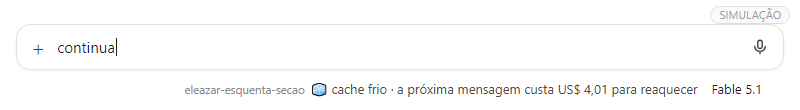
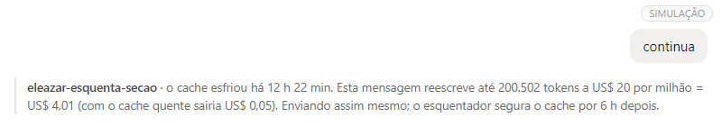
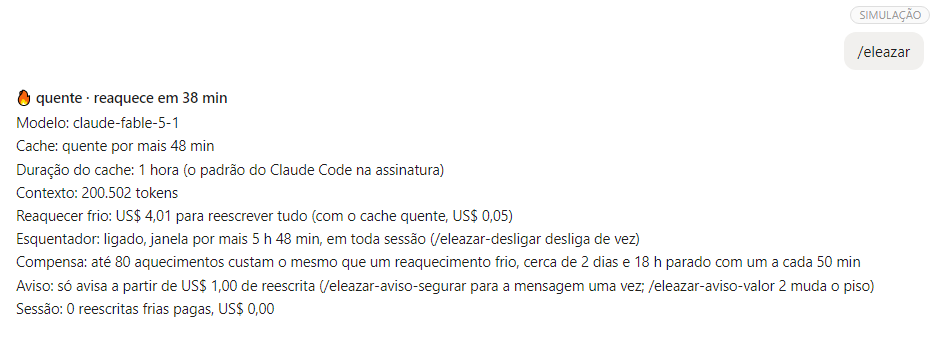

<div align="center">

<h1>Eleazar, o esquenta-sessão</h1>

<p><b>Mantém quente o cache da conversa do Claude Code enquanto você está parado.</b><br>
Mostra embaixo da caixa de mensagem em que pé ele está e avisa o preço antes da mensagem cara.</p>

<p>
  
  
  
  
  
  
</p>

<p>
  <a href="#bê-á-bá-instalar">
    
  </a>
  <br>
  
  <br>
  <sub>Claude Code 2.1.287 ou mais novo · app desktop (aba Code) ou terminal · sem Python, Node ou chave de API · <a href="#pré-requisitos">pré-requisitos</a></sub>
</p>

<p>
  <a href="#o-problema">O problema</a> ·
  <a href="#a-solução">A solução</a> ·
  <a href="#pré-requisitos">Pré-requisitos</a> ·
  <a href="#bê-á-bá-instalar">Instalar</a> ·
  <a href="#bê-á-bá-usar">Usar</a> ·
  <a href="#o-que-ela-não-faz">O que não faz</a> ·
  <a href="#de-onde-veio">De onde veio</a>
</p>

</div>

---

`eleazar-esquenta-secao` é uma mod do Claude Code. Esta é uma amostra daquilo que curamos, adaptamos e criamos na [Mentoria Fábrica de Apps](https://www.joviano.com/vitrine/mentoria-fabrica).

## O problema

O Claude Code guarda a conversa num cache. Enquanto o cache está vivo, cada mensagem nova lê o contexto de lá, pelo preço de leitura, que é baixo. Quando o cache expira, a próxima mensagem precisa escrever o contexto inteiro de novo, pelo preço de escrita, que é dezenas de vezes maior.

Quanto tempo o cache vive:

- **1 hora** na conversa principal, para quem usa o Claude Code pela assinatura;
- **5 minutos** para quem usa créditos, chave de API ou um provedor de nuvem, a não ser que `promptCacheTtl` esteja em `"1h"`.

Ou seja: você para para almoçar, volta, manda "continua" e paga para reescrever a conversa toda. Ninguém avisa.

Um exemplo, pelos preços de tabela que a mod usa (outubro de 2026), numa conversa de 200 mil tokens no Fable 5.1:

| Situação | Custo da próxima mensagem |
| --- | --- |
| Cache quente: o contexto é lido | cerca de US$ 0,05 |
| Cache frio: o contexto é reescrito | cerca de US$ 4,00 |

Na assinatura isso não vira cobrança em dólar: vira consumo do seu limite de uso. O dólar aqui é só a régua.

## A solução

A mod faz três coisas.

**1. Mantém o cache quente.** Depois de 50 minutos sem mensagem, ela manda uma requisição curtinha ao modelo, que lê o contexto do cache e renova a vida dele por mais uma hora. Faz isso até 6 horas depois da sua última mensagem e para. Cada aquecimento também custa: no exemplo acima, uns US$ 0,05.

**2. Mostra o estado o tempo todo.** Embaixo da caixa de mensagem:

| O que aparece | Quer dizer |
| --- | --- |
| 🌡️ **esquentador ligado** · começa depois da sua próxima mensagem | Ainda não há resposta para aquecer, como logo depois de compactar a conversa. |
| 🔥 **quente** · reaquece em 38 min | O cache está quente; a contagem anda sozinha até o próximo aquecimento. |
| 🔥 **quente** · reaquece em instantes | O aquecimento sai no próximo minuto. |
| 🧊 **cache frio** · a próxima mensagem custa US$ 4,01 para reaquecer | O cache já foi; você sabe o preço antes de mandar. |
| ⏸️ **esquentador pausado** | A conta usa cache de 5 minutos, que aquecer a cada 50 minutos não segura. |
| ⚠️ **esquentador parou** | Um aquecimento falhou; o motivo vem na linha, e ele volta depois da sua próxima mensagem. |

No app desktop o estado fica na linha de status, à direita, ao lado do nome do modelo. No terminal, fica na linha de dica, à esquerda.

Assim fica no app desktop, logo depois de uma resposta (print real):


**3. Avisa antes da mensagem cara.** Se o cache esfriou e reescrever vai custar US$ 1 ou mais, a mensagem vai com uma linha dizendo quanto ela vai custar e quanto custaria com o cache quente. Se preferir, a mod pode segurar a mensagem uma vez para você decidir: aí basta mandar de novo para seguir.

As duas imagens abaixo são simulações, montadas com o texto exato que a mod escreve numa conversa de 200 mil tokens no Fable 5.1, depois de uma noite parada.

Antes de mandar, a linha de status já mostra o preço:



Ao mandar, aparece o aviso com a conta:



## Pré-requisitos

| O que precisa | Como conferir |
| --- | --- |
| Claude Code **2.1.287** ou mais novo | No terminal: `claude --version`. O app desktop já vem com o Claude Code dentro: basta estar atualizado. |
| App desktop (aba **Code**) ou Claude Code no terminal | A mod roda nos dois. Na extensão do VS Code e no celular, não testamos. |
| Cache de **1 hora**, para ela conseguir segurar | Na assinatura, a conversa principal já usa 1 hora. Com créditos, chave de API ou provedor de nuvem, o cache dura 5 minutos, a não ser que `promptCacheTtl` esteja em `"1h"`; nesse caso a mod não aquece e só avisa o preço. |

Não precisa de Python, Node, chave de API nem de nada instalado à parte: a mod roda dentro do Claude Code.

## Bê-á-bá: instalar

Confira antes os [pré-requisitos](#pré-requisitos).

**No app desktop (aba Code):** clique no **+** ao lado da caixa de mensagem, abra **Plugins**, adicione o marketplace `jovianosilveira/ia-skills-plugins-specs-mods` e depois adicione o plugin `eleazar-esquenta-secao`.

**Numa sessão do Claude Code no terminal:**

```
/plugin install eleazar-esquenta-secao --marketplace jovianosilveira/ia-skills-plugins-specs-mods
```

Responda `y` para adicionar o marketplace e escolha o escopo de usuário com Enter.

**Pelo terminal do sistema:**

```bash
claude plugin install eleazar-esquenta-secao --marketplace jovianosilveira/ia-skills-plugins-specs-mods
```

Se você tiver o `cache-tax` original instalado, desinstale: os dois juntos dão dois avisos e dois aquecimentos para a mesma pausa.

## Bê-á-bá: usar

1. Abra um novo chat e digite o seu pedido. É ele que liga o Eleazar: até a primeira mensagem, o app ainda não abriu a sessão, e não aparece nada embaixo da caixa.
2. Quando a resposta chegar, aparece **🔥 quente · reaquece em 50 min** embaixo da caixa de mensagem, e a contagem desce sozinha.
3. Pode sair. Se você ficar mais de 50 minutos parado, a mod aquece o cache e a contagem recomeça.
4. Quer ver os números? Digite `/eleazar`. Aparece um cartão com o tamanho do contexto, quanto custaria reaquecer frio, quanto custa cada aquecimento e quantos aquecimentos custam o mesmo que um reaquecimento frio.



*Simulação, com o texto exato do cartão para uma conversa de 200 mil tokens no Fable 5.1.*

Comandos: todos começam com `/eleazar`. Digite `/eleazar` na caixa de mensagem e a lista mostra cada opção com a sua explicação.

| Comando | O que faz |
| --- | --- |
| `/eleazar` | Mostra o cartão com o estado e os preços. |
| `/eleazar-ligar` | Liga de novo, em toda sessão. |
| `/eleazar-desligar` | Desliga nesta sessão e nas próximas. |
| `/eleazar-status` | Mostra o estado numa linha só. |
| `/eleazar-janela 90m` | Abre uma janela de 90 minutos (`/eleazar-janela 90m a cada 2m` serve para testar). |
| `/eleazar-aviso-avisar` | A mensagem com o cache frio passa, com o preço mostrado (é o padrão). |
| `/eleazar-aviso-segurar` | A mensagem com o cache frio é segurada uma vez; mandou de novo, ela passa. |
| `/eleazar-aviso-valor 2` | O aviso só aparece quando reescrever custar US$ 2 ou mais (o padrão é US$ 1). |

Para desinstalar:

```bash
claude plugin uninstall eleazar-esquenta-secao
```

## O que ela não faz

- Não é de graça: cada aquecimento lê o contexto e gasta tokens. O cartão do `/eleazar` mostra a conta para você decidir.
- Não segura cache de 5 minutos. Nessas contas ela pausa e só avisa o preço.
- Não aquece para sempre: para 6 horas depois da sua última mensagem.
- Os valores em dólar são estimativas pela tabela de preços embutida no código, que pode ficar desatualizada.
- No app desktop, nos nossos testes, a linha de dica do lado esquerdo não mostrou o que a mod desenhou nela. Por isso, lá, o estado fica do lado direito.
- No app desktop, chat novo não mostra nada antes da primeira mensagem: o app só abre a sessão, e a mod junto, quando você manda o primeiro pedido.

## Por que Eleazar

No método GENESIS, da [Mentoria Fábrica de Apps](https://www.joviano.com/vitrine/mentoria-fabrica), os ajudantes levam nomes de personagens bíblicos: Arão faz os vídeos, José planeja, Salomão monta o time.

Eleazar era filho de Arão e sacerdote, e cuidava do azeite da luz do santuário (Números 4:16). A regra do altar, em Levítico 6:12-13, é que o fogo tinha que arder sem parar: toda manhã o sacerdote punha lenha nele, para que nunca se apagasse.

É o que esta mod faz com o cache: põe lenha antes que o fogo apague.

## De onde veio

A mod parte do [cache-tax](https://github.com/karanb192/cache-tax), de Karan Bansal (licença MIT). A ideia e o motor de aquecimento são dele. Lemos o código inteiro antes de usar e partimos de uma cópia travada na versão e4940af: uma mod roda código dentro do seu Claude Code, então nada entra aqui sem revisão.

### O que foi corrigido

- **O tempo de vida do cache.** O original supõe sempre 1 hora. Em contas com cache de 5 minutos (créditos, chave de API, provedor de nuvem), isso dava dois problemas. O preço da reescrita saía errado, porque a escrita de 5 minutos custa 1,25 vez o preço de entrada, e não 2 vezes. E o primeiro aquecimento, 50 minutos depois, já encontrava o cache morto e pagava a reescrita inteira, sem segurar nada. Agora a mod lê as configurações (`promptCacheTtl` e as variáveis de ambiente do cache) e confirma pelo que as próprias mensagens mostram: se, depois de uma pausa de 5 a 60 minutos, o contexto foi lido de volta, o cache é de 1 hora; se foi reescrito, é de 5 minutos. Com cache de 5 minutos, ela não aquece e só avisa o preço.
- **O aviso barrava a mensagem.** No original, a primeira mensagem com o cache frio era descartada e você tinha que mandar de novo. Aqui o padrão é deixar passar mostrando o preço. Quem prefere ser barrado usa `/eleazar-aviso-segurar`.
- **O aviso contava tokens, não dinheiro.** O original avisava a partir de 50 mil tokens de contexto, qualquer que fosse o modelo. Só que 50 mil tokens custam cerca de US$ 0,01 para reescrever no Haiku 5.5 e US$ 1,00 no Fable 5.1. Agora o aviso vai por dólar, a partir de US$ 1, e o piso muda com `/eleazar-aviso-valor <valor>`.
- **No app desktop, a sessão nova abria sem sinal da mod.** O original só desenha o estado na tela quando a sessão se identifica como terminal ou desktop, e as sessões que o app desktop abre não se identificam assim. Nelas, o estado ia para a linha de status só enquanto o aquecimento estava armado, e ele vinha desligado. Agora o estado aparece desde a primeira mensagem.

### O que foi adaptado para a nossa realidade

- **Português do Brasil em tudo:** a linha de estado, os avisos, o cartão e os comandos. Valores no formato daqui (US$ 4,01; 200.502 tokens) e tempos como a gente fala (38 min, 2 h 5 min, 3 dias).
- **Comandos em português, todos começando com `/eleazar`.** Digitou `/eleazar`, aparecem todas as opções: ligar, desligar, status, janela e aviso. O original tem dois comandos em inglês, `/keepwarm` e `/cache-tax`, com as opções escritas depois deles.
- **Ligado desde a instalação.** No original, o aquecimento só liga com `/keepwarm` (ou `/keepwarm always`). Aqui ele já vem ligado em toda sessão, e `/eleazar-desligar` desliga de vez.
- **Feito para o app desktop.** O estado fica na linha de status, ao lado do modelo, com ícone e uma contagem regressiva que anda sozinha, minuto a minuto. O cartão do `/eleazar` vem em linhas "Rótulo: valor", porque o app usa fonte proporcional e colunas alinhadas se desmancham.
- **O cache frio vira preço na tela.** O original mostra que o cache esfriou. Aqui a linha diz quanto a próxima mensagem vai custar, antes de você mandar.
- **Convive com o original sem cobrar em dobro.** Se o `cache-tax` também estiver instalado, a mod avisa: os dois juntos dão dois avisos e dois aquecimentos para a mesma pausa.

Os testes do original continuam aqui, adaptados ao português, e cada correção e adaptação ganhou testes próprios: são 169 ao todo. Para rodar: `claude plugin test eleazar-esquenta-secao`.
